The GitHub home of AISS, Bocconi’s AI in Social Sciences Lab. Templates, tools and workflows for AI-powered research, open to every department and research centre at Bocconi University.

<table>
<tr>
<th width="33%"></th>
<th width="33%"></th>
<th width="33%"></th>
</tr>
<tr>
<td>🚀 Start from the <a href="https://aiss-unibocconi-eu.github.io/aiss-research-template/">AISS research template</a>.</td>
<td>📘 Git, uv and the rest of the workflow in the <a href="https://github.com/aiss-unibocconi-eu/handbook">handbook</a>.</td>
<td>🎙️ Short afternoon talks on AI methods for social science, with live Q&amp;A. <a href="https://aiss-unibocconi-eu.github.io/aiss-bytes">Schedule →</a></td>
</tr>
</table>

🌐 [aiss.unibocconi.eu](https://aiss.unibocconi.eu/) · ✉️ [aiss@unibocconi.it](mailto:aiss@unibocconi.it)
